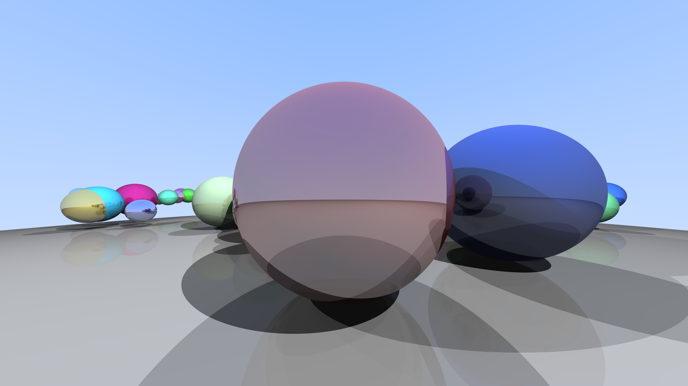

# Parallel Ray Tracer (MPI + OpenMP)

A CPU ray tracer in C++ with four parallel implementations, built for a Parallel and Distributed
Computing course project. It compares a sequential renderer against OpenMP, MPI and hybrid
MPI + OpenMP versions, and measures speedup, load balance and scaling up to 8K (7680 x 4320).



## The renderer

- Spheres, Lambertian shading with a small ambient term, three point lights
- Hard shadows (one shadow ray per light), recursive reflections with a maximum depth
- Multiple samples per pixel (anti-aliasing) with a **per-pixel deterministic random generator**, so every
  version produces a bit-identical image regardless of thread, rank or tile layout
- Scene: three fixed spheres plus N random spheres from a fixed seed (default 42). Every MPI rank builds
  the same scene itself, so nothing about the scene is sent over MPI
- The ground is a sphere of radius 100, not a true plane, so the horizon curves slightly
- Output is a plain-text PPM image

The foundation (vectors, rays, camera, hit testing, anti-aliasing) follows Peter Shirley's
*Ray Tracing in One Weekend* (https://raytracing.github.io). Point lights, shadow rays, reflections,
the tile-based rendering function, all parallel versions and the benchmarking are our own additions.

## Versions

| Version | Source | Build target | What it does |
|---|---|---|---|
| Sequential | `seq_omp/main.cc` | `make seq` | Single thread |
| OpenMP | `seq_omp/main.cc` | `make omp` | `parallel for` over rows inside `render_tile`, schedule chosen with `OMP_SCHEDULE` |
| MPI | `mpi_hybrid/main.cc` | `make mpi` | `--mode static`: contiguous row blocks per rank, `MPI_Gatherv` on rank 0. `--mode dynamic`: master-worker tile queue, rank 0 coordinates and ranks 1.. render |
| Hybrid | `mpi_hybrid/main.cc` | `make hybrid` | The MPI program built with `-fopenmp`; each rank renders its tiles with OpenMP threads (`MPI_THREAD_FUNNELED`) |

All four share the same code in `src/`. Every version renders through `camera::render_tile(x0, y0, w, h, ...)`,
which fills a buffer for any rectangle of the image using global pixel coordinates for the random seeds.

## Requirements

- g++ with C++17 and OpenMP support, `make`
- Open MPI (`openmpi-bin libopenmpi-dev`)
- Python 3 with matplotlib (`python3-matplotlib`) for the benchmark and plotting scripts
- ImageMagick (`convert`) to turn PPM files into PNG

Developed and measured on Ubuntu 24.04 under WSL2 (Intel Core i5-1135G7, 4 cores / 8 threads).

```bash
sudo apt update
sudo apt install -y build-essential openmpi-bin libopenmpi-dev python3-matplotlib imagemagick
```

## Build

```bash
make seq omp mpi hybrid      # binaries are written to bin/
make clean                   # remove bin/
```

## Run

All programs accept the same scene options. The image goes to stdout (or to `--out FILE` for the MPI
programs) and a one-line timing summary starting with `RESULT` goes to stderr.

```bash
# Sequential and OpenMP
./bin/raytracer_seq --width 1920 --spp 16 --objects 100 > out.ppm
OMP_SCHEDULE="dynamic,1" ./bin/raytracer_omp --width 1920 --spp 16 --objects 100 --threads 8 > out.ppm

# MPI, static row blocks, 4 ranks
mpirun --bind-to none --use-hwthread-cpus -np 4 ./bin/raytracer_mpi \
    --width 1920 --spp 16 --objects 100 --out out.ppm

# MPI, dynamic master-worker: rank 0 only coordinates, so -np 5 means 4 workers
mpirun --bind-to none --use-hwthread-cpus -np 5 ./bin/raytracer_mpi \
    --mode dynamic --tile 64 --width 1920 --spp 16 --objects 100 --out out.ppm

# Hybrid, dynamic: 2 workers x 4 threads (plus the coordinator)
OMP_SCHEDULE="dynamic,1" mpirun --bind-to none --use-hwthread-cpus --oversubscribe -x OMP_SCHEDULE -np 3 \
    ./bin/raytracer_hybrid --mode dynamic --threads 4 --width 1920 --spp 16 --objects 100 --out out.ppm

convert out.ppm out.png      # view the result
```

| Option | Default | Meaning |
|---|---|---|
| `--width N` | 400 | Image width in pixels (16:9, so 1920 gives 1080p and 7680 gives 8K) |
| `--spp N` | 10 | Samples per pixel |
| `--depth N` | 5 | Maximum reflection depth |
| `--objects N` | 50 | Number of random spheres |
| `--seed N` | 42 | Seed for the random spheres |
| `--threads N` | all | OpenMP threads (OpenMP and hybrid builds) |
| `--mode static\|dynamic` | static | MPI work distribution (MPI and hybrid builds) |
| `--tile N` | 64 | Tile size for dynamic mode |
| `--out FILE` | stdout | Output file for the MPI programs |

Practical notes:

- Use `--out FILE` with MPI. Writing a large image through `mpirun`'s stdout was 30 times slower in our tests.
- Set `OMP_SCHEDULE="dynamic,1"` for the OpenMP and hybrid builds. Without it OpenMP uses its default
  (static) schedule, which balances this scene poorly.
- In hybrid runs keep ranks x threads at or below the number of hardware threads.
- Do not pin threads inside WSL2 (`OMP_PROC_BIND`, `--bind-to core`): it made OpenMP about 20% slower here.

## Checking correctness

All versions must produce the identical image. This reference image can be checked with a checksum:

```bash
./bin/raytracer_seq --width 400 --spp 10 --objects 100 > ref.ppm
md5sum ref.ppm       # 56b7db7050c821d9e94f209f381388ed
```

Compare any other version with `cmp ref.ppm other.ppm` (no output means identical). The benchmark
script runs this check on every configuration before it measures anything.

## Benchmarks and figures

```bash
python3 scripts/bench.py --suite smoke --repeats 1     # quick check
python3 scripts/bench.py --suite main --repeats 3      # 1080p, SPP 16: all versions and configurations
python3 scripts/bench.py --suite resolution            # 720p, 1080p, 4K at SPP 4
python3 scripts/bench.py --suite complexity            # SPP, depth and object-count sweeps
python3 scripts/bench.py --suite big                   # 8K at SPP 4
python3 scripts/plot.py                                # summary table and figures from results/*.csv
```

`bench.py` runs the configurations of a suite interleaved in a shuffled order each round, so slow
drift of the machine affects all of them equally, and appends one row per run to `results/<suite>.csv`.
`plot.py` writes `results/summary.csv` (median, best of runs, speedup, efficiency) and the figures
`results/fig_*.png`. `NOTES.md` holds the measurement log.

## Results

Speedup against the sequential run of the same suite, median of 3 runs.

**1080p, SPP 16** (sequential 99.7 s):

| Configuration | Time | Speedup |
|---|---|---|
| OpenMP, 8 threads | 33.0 s | 3.02x |
| Hybrid static 1 rank x 8 threads | 32.7 s | 3.05x |
| Hybrid dynamic 2 workers x 4 threads | 37.2 s | 2.68x |
| MPI dynamic, 4 workers | 46.1 s | 2.16x |
| MPI static, 4 ranks | 65.7 s | 1.52x |

**8K (7680 x 4320), SPP 4** (sequential 377 s):

| Configuration | Time | Speedup |
|---|---|---|
| OpenMP, 8 threads | 125.9 s | 3.00x |
| Hybrid dynamic 2 x 4 | 151.5 s | 2.49x |
| MPI dynamic, 4 workers | 182.6 s | 2.07x |
| MPI static, 4 ranks | 260.9 s | 1.45x |

What the measurements show:

- The image is very uneven: sky pixels cost one ray, ground and mirror pixels cost many. With static
  row blocks the fastest MPI process finishes in a fraction of the time of the slowest one. Dynamic
  tile distribution removes that imbalance and is 1.43x faster than static on 4 compute ranks, at both
  1080p and 8K.
- OpenMP speedup flattens at about 3x. The machine has 4 physical cores, and a test running 4
  independent copies of the sequential program showed they slow each other by about 15%, so about
  3.5x is the ceiling. Hyperthreads add almost nothing for this workload.
- Run time is linear in pixel count, samples per pixel and number of objects (every ray tests every
  sphere), and reflection depth stops mattering after about depth 5.
- On one node MPI adds no benefit over OpenMP: shared-memory MPI makes communication nearly free,
  so these results cannot say how the versions compare on a cluster.

## Limitations

- Single machine under WSL2, so MPI runs on shared memory and communication cost is far lower than on a real cluster.
- Timings on this laptop drift. Runs of a few seconds varied by up to about 40% between rounds, while runs of
  several minutes varied by 2 to 5%, so the 8K results are the most reliable. Compare numbers only within one suite.
- The 8K benchmark uses SPP 4 so that every configuration, including the sequential one, could be repeated three times.
  Run time was verified to scale linearly with SPP.
- The 10 to 20% gap between dynamic MPI and OpenMP at the same number of compute threads has not been explained.

## Repository layout

```
src/            shared renderer: vec3, ray, camera (render_tile), hittable, sphere, scene, rtweekend
seq_omp/        main.cc for the sequential and OpenMP builds
mpi_hybrid/     main.cc for the MPI and hybrid builds
scripts/        bench.py (benchmark driver), plot.py (summary and figures)
results/        CSV measurements, summary.csv and figures
assets/         rendered images
NOTES.md        measurement log and findings
Makefile
```

## License and credits

See `LICENSE`. Based on the structure of *Ray Tracing in One Weekend* by Peter Shirley, Trevor David Black
and Steve Hollasch (https://raytracing.github.io).
